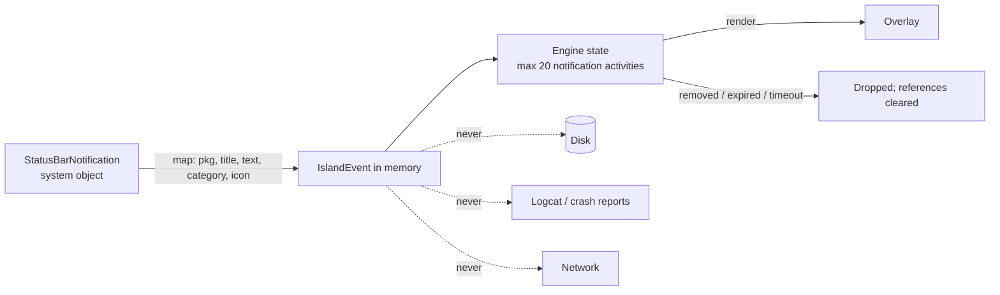

# Database & Data Design — Island

Version 0.1 · 2026-11-11 · Status: Draft for approval

---

## 1. Principles

1. **Persist configuration, not content.** Nothing from another app's notification (title, text, icon, people) is ever written to disk.
2. **Transient by default.** Live activity state is rebuilt from the system on process start. It isn't restored from disk, except timers, whose state *is* the user's own data.
3. **Smallest store that works.**
   - DataStore holds one typed settings document, read as a `StateFlow`.
   - Room holds only collections that need queries or per-row updates.
4. **No DB access on the hot path.** The engine reads settings and rules from in-memory `StateFlow` snapshots. Writes happen only on user actions.

---

## 2. What is stored where

| Data | Store | Persistent? | Why |
|---|---|---|---|
| Global island settings (size, position, theme, motion, toggles) | DataStore `island_settings.json` | ✅ | One document, read as a whole, changes rarely |
| Activity type config (enabled, order, per-type appearance) | DataStore (same document) | ✅ | Fixed small set of types |
| Onboarding/consent flags | DataStore | ✅ | Gate for NLS processing (C5) |
| Per-app notification rules | Room `app_notification_rule` | ✅ | Hundreds of rows, queried by package, edited individually |
| Running timer / stopwatch | Room `timer` | ✅ | Must survive process death and reboot (FR-TIM) |
| Custom themes (Pro) | Room `custom_theme` | ✅ | User-created list |
| Pro entitlement cache | DataStore `entitlement.json` | ✅ (cache only) | Source of truth is Play Billing. Re-validated on start |
| Active notifications, previews | Memory (engine state) | ❌ | Sensitive. Rebuilt via `getActiveNotifications()` |
| Media metadata, artwork | Memory (LRU, ≤ 4 bitmaps, ≤ 256 px) | ❌ | Rebuilt from sessions |
| Battery state | Memory | ❌ | Sticky broadcast gives the current value instantly |
| Island presentation state (expanded, queue) | Memory | ❌ | Meaningless after restart |
| Snooze-until timestamp | DataStore | ✅ | User intent should survive restart |
| Low-battery "already alerted this cycle" flag | DataStore | ✅ | Prevents repeat alerts after process restart |
| Diagnostics (OEM, last kill/rebind times, counts) | DataStore `diagnostics.json`, ring buffer of last 50 *non-content* events | ✅ (local only) | Support/debugging of OEM kills. Exportable by user only |

---

## 3. DataStore schema

Typed `DataStore<IslandSettings>` with a kotlinx-serialization JSON `Serializer`. It includes a `schemaVersion` field and explicit migration functions. Corruption is handled by `ReplaceFileCorruptionHandler` → defaults.

```kotlin
@Serializable
data class IslandSettings(
    val schemaVersion: Int = 1,
    val islandEnabled: Boolean = true,
    val consent: ConsentState = ConsentState(),
    val geometry: Geometry = Geometry(),
    val appearance: Appearance = Appearance(),
    val motion: Motion = Motion(),
    val behavior: Behavior = Behavior(),
    val activities: Map<ActivityType, ActivityConfig> = ActivityConfig.defaults(),
    val notificationDefaults: NotificationDefaults = NotificationDefaults(),
    val privacy: PrivacySettings = PrivacySettings(),
    val snoozedUntilEpochMs: Long? = null,
    val batteryAlertState: BatteryAlertState = BatteryAlertState(),
)

@Serializable data class ConsentState(
    val onboardingCompleted: Boolean = false,
    val notificationDisclosureAcceptedAt: Long? = null,   // epoch ms; gates NLS processing
    val disclosureVersion: Int = 0,                         // bump → re-consent
)

@Serializable data class Geometry(
    val anchor: Anchor = Anchor.CUTOUT,          // CUTOUT | TOP_CENTER | BELOW_STATUS_BAR
    val offsetXdp: Float = 0f, val offsetYdp: Float = 0f,     // clamped ±48 / 0..64
    val compactHeightDp: Float = 34f,            // 28..44
    val compactMinWidthDp: Float = 120f,         // 96..220
    val expandedWidthFraction: Float = 0.92f,    // 0.7..0.96 of screen width
    val cornerRadiusPercent: Int = 100,          // 40..100 (100 = full pill)
    val wrapCornerCamera: Boolean = false,
)

@Serializable data class Appearance(
    val themeMode: ThemeMode = ThemeMode.SYSTEM, // SYSTEM | LIGHT | DARK | AMOLED
    val themeId: String = "builtin.midnight",    // builtin.* or custom.<uuid> (Room)
    val accent: AccentSource = AccentSource.Dynamic,   // Dynamic | Preset(id) | Custom(argb) [Pro]
    val outline: Boolean = false,
    val shadow: Boolean = true,
)

@Serializable data class Motion(
    val preset: MotionPreset = MotionPreset.STANDARD,  // RELAXED | STANDARD | SNAPPY | REDUCED | (Pro) ELASTIC, LIQUID
    val respectSystemAnimatorScale: Boolean = true,
    val haptics: Boolean = true,
)

@Serializable data class Behavior(
    val hideInLandscape: Boolean = true,
    val hideInFullscreen: Boolean = true,
    val autoCollapseSeconds: Int = 8,            // 4..20
    val minDisplaySeconds: Float = 2.5f,
    val splitPillEnabled: Boolean = true,
    val reliabilityMode: Boolean = false,        // opt-in FGS
)

@Serializable data class ActivityConfig(
    val enabled: Boolean,
    val order: Int,                               // user priority order
    val timedDisplaySeconds: Int? = null,         // per type override
    val layout: String = "default",               // "default" | "pro.large_art" ...
    val appearanceOverrideThemeId: String? = null // Pro
)

@Serializable data class NotificationDefaults(
    val defaultRule: NotificationRule = NotificationRule.SHOW_REDACTED,
    val messagingDefaultRule: NotificationRule = NotificationRule.SHOW_FULL,
    val showOngoing: Boolean = false,
    val cancelSystemNotificationOnDismiss: Boolean = false,
    val previewSeconds: Int = 5,
)

@Serializable data class PrivacySettings(
    val redactWhenLocked: Boolean = true,         // user may disable; default on
    val redactWhenScreenRecording: Boolean = true,
    val diagnosticsEnabled: Boolean = true,       // local only
)

@Serializable data class BatteryAlertState(
    val lowAlertedThisCycle: Boolean = false,
    val fullAlertedThisCycle: Boolean = false,
    val lowThresholdPercent: Int = 15,
    val fullAlertEnabled: Boolean = true,
)
```

**Read path:** `SettingsRepository.settings: StateFlow<IslandSettings>` (`stateIn(appScope, Eagerly, IslandSettings())`). Consumers map with `distinctUntilChanged` to the slice they need, so a geometry change doesn't wake the notification filter.

**Write path:** `updateData { it.copy(...) }` from ViewModels on the IO dispatcher. Slider changes are debounced at 150 ms for persistence, but the live preview is driven by an in-memory override flow so it stays instant (FR-SET-01).

---

## 4. Room schema

Database `island.db`, version 1. `exportSchema = true`, with schemas committed under `core/data/schemas/` for migration tests.

### 4.1 `app_notification_rule`
| Column | Type | Constraints | Notes |
|---|---|---|---|
| `package_name` | TEXT | **PK** | |
| `rule` | TEXT | NOT NULL, enum `SHOW_FULL`/`SHOW_REDACTED`/`BLOCK` | |
| `show_ongoing` | INTEGER (bool) | NOT NULL DEFAULT 0 | Allow ongoing notifs for this app |
| `priority_boost` | INTEGER | NOT NULL DEFAULT 0, range −20..+40 | User "important app" |
| `updated_at` | INTEGER | NOT NULL | epoch ms |

No app label/icon is stored. They're resolved at display time from `PackageManager`. Rows for uninstalled packages are pruned on `ACTION_PACKAGE_FULLY_REMOVED` (context-registered while running) and on app start.

Read pattern: `Flow<Map<String, AppRuleEntity>>` collected once → in-memory map snapshot used by `EventProcessor`. There are no per-event queries.

### 4.2 `timer`
| Column | Type | Constraints | Notes |
|---|---|---|---|
| `id` | TEXT | **PK** (UUID) | |
| `mode` | TEXT | NOT NULL `COUNTDOWN`/`STOPWATCH` | |
| `state` | TEXT | NOT NULL `RUNNING`/`PAUSED`/`FINISHED` | |
| `duration_ms` | INTEGER | NULL for stopwatch | |
| `started_at_epoch_ms` | INTEGER | NOT NULL | Wall clock; survives reboot |
| `started_at_elapsed_ms` | INTEGER | NOT NULL | `SystemClock.elapsedRealtime` at start; valid only while `boot_count` matches |
| `boot_count` | INTEGER | NOT NULL | `Settings.Global.BOOT_COUNT`. Mismatch → recompute from wall clock |
| `accumulated_ms` | INTEGER | NOT NULL DEFAULT 0 | Running time before the last pause |
| `label` | TEXT | NULL, ≤ 40 chars | User-entered |
| `created_at` | INTEGER | NOT NULL | |

**Remaining time:** `remaining = duration − (accumulated + (nowElapsed − startedElapsed))` if `boot_count` matches; otherwise use the wall-clock delta. A wall-clock change by the user between reboots is accepted error (rare).

Finished timers are deleted 1 minute after the user dismisses the alert. **There is no history table in MVP.**

### 4.3 `custom_theme` (Pro)
| Column | Type | Notes |
|---|---|---|
| `id` | TEXT PK (UUID) | |
| `name` | TEXT NOT NULL ≤ 30 | |
| `background_argb` | INTEGER NOT NULL | |
| `content_argb` | INTEGER NOT NULL | |
| `accent_argb` | INTEGER NOT NULL | |
| `gradient_end_argb` | INTEGER NULL | Gradient themes |
| `style` | TEXT NOT NULL | `SOLID`/`GRADIENT`/`GLASS`/`ARTWORK_ADAPTIVE` |
| `created_at` / `updated_at` | INTEGER | |

### 4.4 Entity sketch

```kotlin
@Entity(tableName = "app_notification_rule")
data class AppRuleEntity(
    @PrimaryKey @ColumnInfo(name = "package_name") val packageName: String,
    val rule: NotificationRule,
    @ColumnInfo(name = "show_ongoing") val showOngoing: Boolean = false,
    @ColumnInfo(name = "priority_boost") val priorityBoost: Int = 0,
    @ColumnInfo(name = "updated_at") val updatedAt: Long,
)

@Database(entities = [AppRuleEntity::class, TimerEntity::class, CustomThemeEntity::class], version = 1, exportSchema = true)
@TypeConverters(EnumConverters::class)
abstract class IslandDatabase : RoomDatabase() { /* dao accessors */ }
```

### 4.5 Migrations
- Every schema change ships with a `Migration` (or `AutoMigration` with spec) and a `MigrationTestHelper` test from the previous exported schema.
- `fallbackToDestructiveMigration` is **not** used (it would lose rules and running timers).

---

## 5. Data lifecycle and privacy



| Data class | Created | Lives in | Destroyed |
|---|---|---|---|
| Notification content | `onNotificationPosted` | Engine state (memory) | `onNotificationRemoved`, expiry, process death, user "clear", or when > 20 items (oldest first) |
| Artwork bitmap | Media metadata change | LRU cache (≤ 4 entries) | Eviction, session end + 30 s, `onTrimMemory(≥ RUNNING_LOW)` |
| Settings | User action | DataStore | "Delete all data" or uninstall |
| App rules | User action, or first time an app is configured | Room | Package removal, delete-all, uninstall |
| Timers | User start | Room | Dismissed + 1 min, delete-all |
| Diagnostics | Lifecycle events (bind, unbind, kill detected, OEM) | DataStore ring buffer | User clear, 50-entry cap, uninstall |

### 5.1 Enforcement mechanisms
1. **Type-level:** `core:data` has no dependency on `ActivityContent.Notification`. No entity or serializer can reference it. A module-dependency test fails if `core:data` imports `core.model.content.Notification*`.
2. **Logging:** a single `Logger` facade. In release, `IslandEvent.toString()` is overridden to print only `source` + `key`, with no content. A lint check bans `Log.*` calls outside the facade.
3. **Crash reporting:** none in MVP (Play Vitals only). If added later, a scrubber must strip all strings from breadcrumbs, and it must be opt-in.
4. **Backup:** `dataExtractionRules.xml` includes DataStore settings and the Room `app_notification_rule` table (via DB file include). Timers are excluded. Diagnostics are excluded.
5. **Screenshots/recents:** the main app's privacy screen is not sensitive. No `FLAG_SECURE` is needed. The overlay applies redaction instead when screen recording is detected (API 35+).
6. **Delete all data:** clears DataStore files, the Room DB, the bitmap cache, and the in-memory engine state, cancels alarms, and restarts the overlay host.

### 5.2 Encryption at rest
Stored data (preferences, rules, timer timestamps, theme colors) is non-sensitive, and the app sandbox plus file-based encryption already protect it. `EncryptedSharedPreferences`/Jetpack Security-crypto is **not** used (that library is deprecated and adds complexity with no benefit for this data).

---

## 6. Performance rules for data access
- No Room or DataStore read in any event-processing path. Use `StateFlow` snapshots only.
- Room queries return `Flow` and are collected once per process.
- Writes are batched where natural, e.g. "apply rule to all messaging apps" runs in one transaction.
- DataStore writes from sliders are debounced at 150 ms.
- Timer writes happen only on state transitions (start/pause/resume/finish), never per tick.
