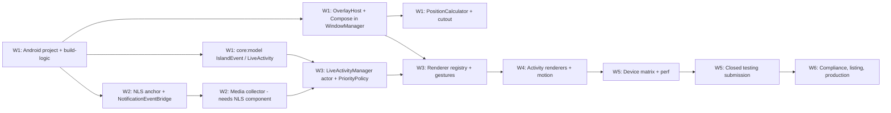

# Development Roadmap — Six-Week MVP

Version 0.1 · 2026-11-11 · Status: Draft for approval

**Assumptions:**
- One senior Android engineer full-time (≈ 5 dev-days/week).
- Part-time design input in Weeks 1 and 4, part-time QA in Weeks 5 and 6.
- Physical devices per ANDROID_COMPATIBILITY §7.1 are available by Week 2.
- Week 1 starts only after the plan is approved.

**Priority tags:** **P0** must ship. **P1** cut first if the critical path slips. **Stretch** only if ahead.

---

## Milestones

| Milestone | End of | Exit criteria |
|---|---|---|
| **M0 Plan approved** | Week 0 | This document set approved, open questions in docs/README.md answered |
| **M1 Overlay spike proven** | Week 1 | Prototypes P1, P4, P5 answered with written findings. Overlay shows a Compose pill around the cutout on Pixel + Samsung |
| **M2 Signals flowing** | Week 2 | All 4 collectors emit normalized events. P2 and P3 findings recorded. Reliability-mode decision made |
| **M3 Engine complete** | Week 3 | Real activities appear, prioritize, expire, and respond to gestures end-to-end |
| **M4 Feature-complete MVP** | Week 4 | All P0 screens, customization, themes, animations. Internal dogfood build |
| **M5 Release candidate** | Week 5 | Device matrix pass, performance targets measured, closed-testing track submitted |
| **M6 Store-ready** | Week 6 | Compliance checklist complete, production rollout plan, listing assets |

---

## Critical path

**Critical-path items** (any slip here moves launch):
1. Overlay host with Compose (W1).
2. NLS as process anchor (W2), since media depends on it.
3. Actor engine (W3).
4. Closed-track submission (W5), since Play review time is outside our control.

**Off the critical path:** billing, Pro themes, Quick Settings tile, OEM guidance polish, split pill.

---

## Week 1 — Android foundation & floating overlay

**Goal:** a real Android project with module skeleton and CI, and a de-risked overlay.

### Tasks
| # | Task | Pri |
|---|---|---|
| 1.1 | `git init`. Back up the IntelliJ template (`src/main/kotlin/Main.kt`, root `build.gradle.kts`). Replace with an Android multi-module build (with user approval). JDK 21 toolchain. Version catalog | P0 |
| 1.2 | `build-logic` convention plugins: `island.android.application`, `island.android.library`, `island.android.compose`, `island.jvm.library`, `island.hilt`, `island.test` | P0 |
| 1.3 | Create all modules (empty) per TECHNICAL_ARCHITECTURE §4, with dependency rules | P0 |
| 1.4 | CI (GitHub Actions or local script): build, unit tests, lint, detekt/ktlint, merged-manifest forbidden-permission check | P0 |
| 1.5 | `core:model` v0: `IslandEvent`, `LiveActivity`, `ActivityContent`, `IslandState`, `UserIntent` | P0 |
| 1.6 | `OverlayHost` (lifecycle/saved-state owners), `WindowController` (add/update/remove, frame coalescing), debug-only "Show test pill" button in `MainActivity` | P0 |
| 1.7 | `PositionCalculator`: cutout anchor, no-cutout fallback, rotation recompute | P0 |
| 1.8 | **Prototype P1:** z-order vs status bar and shade, lock screen visibility. Screenshots on Pixel + Samsung (+ Xiaomi if available) | P0 |
| 1.9 | **Prototype P4:** compact↔expanded with ≤ 2 relayouts. Measure frame timing (Perfetto) and touch pass-through | P0 |
| 1.10 | **Prototype P5:** immersive detection via overlay insets with YouTube full-screen and a game | P0 |
| 1.11 | Measure baseline memory of the overlay process with Compose (`dumpsys meminfo`) | P0 |

### Dependencies
- Stable AGP version compatible with Gradle 9.6 and Kotlin 2.4.x (verify day 1; if incompatible, change the Gradle wrapper, not Kotlin).
- At least one Pixel and one Samsung device.

### Deliverables
- Building multi-module project, green CI.
- `docs/prototypes/P1-P4-P5-findings.md` with screenshots, numbers, and a decision for each.

### Acceptance criteria
- [ ] `./gradlew build` passes from clean in < 3 min on the dev machine. `testDebugUnitTest` runs.
- [ ] A test pill appears centered on the camera cutout (± 1 dp) on Pixel and Samsung, survives rotation (hidden in landscape), and repositions within 1 frame of the config change.
- [ ] Expand/collapse animation shows ≤ 2 `updateViewLayout` calls per transition (verified by debug counter) and ≤ 1 % janky frames (Perfetto/`gfxinfo`).
- [ ] Taps 1 dp outside the pill reach the underlying app (manual test with a button underneath).
- [ ] Overlay process PSS with pill visible recorded. Go/no-go vs NFR-04 (≤ 80 MB).
- [ ] Merged manifest contains no forbidden permissions (CI check).

### Testing
- Unit: `PositionCalculator` with table-driven cutout fixtures (punch-hole center, notch, corner, none, landscape).
- Manual: P1/P4/P5 protocol per TESTING_STRATEGY §5.3.

### Potential blockers
- AGP/Kotlin/Gradle version mismatch → pin versions to the latest mutually compatible stable set.
- P1 shows status icons overlapping the pill badly → switch the default anchor to "below status bar" for affected devices (capability flag).
- Compose overlay memory > 100 MB → escalate ADR-03 decision immediately.

---

## Week 2 — System event collectors

**Goal:** all signal sources produce normalized `IslandEvent`s. The process-anchor model is validated.

### Tasks
| # | Task | Pri |
|---|---|---|
| 2.1 | `IslandNotificationListener` (Hilt `@AndroidEntryPoint`): connect/disconnect → `OverlayHostController`; posted/removed/ranking → `NotificationEventBridge` | P0 |
| 2.2 | `NotificationFilter` + `NotificationMapper` (pure functions over a minimal `NotificationSnapshot` DTO built on the main thread) | P0 |
| 2.3 | App label/icon resolution with `<queries>` + fallbacks (R9) | P0 |
| 2.4 | `MediaSessionCollector`: active sessions listener, per-controller callbacks, playing-session selection, artwork downscale, transport commands | P0 |
| 2.5 | `BatteryCollector`: sticky intent + receivers, `distinctUntilChanged`, low/full cycle logic | P0 |
| 2.6 | `TimerRepository` + `TimerAlarmScheduler` (exact/inexact) + `TimerAlarmReceiver` + `BootReceiver` | P0 |
| 2.7 | `PermissionMonitor` with `StateFlow<PermissionSnapshot>` | P0 |
| 2.8 | `core:data`: DataStore `IslandSettings` serializer + Room DB v1 with exported schema | P0 |
| 2.9 | **Prototype P2:** 24 h soak on each available OEM device (screen off, mixed use), logging bind/unbind/kill events to local diagnostics | P0 |
| 2.10 | **Prototype P3:** tap-to-open of `contentIntent` for the top 20 apps (WhatsApp, Gmail, Telegram, Instagram, Slack, Messages, Calendar, …) via direct send vs trampoline | P0 |
| 2.11 | Debug "event inspector" screen (debug builds only) listing the last 50 events (keys only) | P1 |

### Dependencies
- Week 1 module skeleton and `core:model`.
- Notification access granted on test devices (`adb shell cmd notification allow_listener <component>`).

### Deliverables
- Collectors with unit tests. Findings doc for P2/P3. **ADR-04 final decision** (Reliability mode in or out of v1).

### Acceptance criteria
- [ ] Posting a test notification (`adb shell cmd notification post`) produces exactly 1 `Upsert` event. Reposting the same content within 500 ms produces 0 additional events.
- [ ] Media: playing in Spotify/YouTube Music/a podcast app produces events with title/artist/artwork ≤ 256 px. Play/pause/next from a test harness controls playback.
- [ ] Track change produces ≤ 1 coalesced upsert (no artwork flash).
- [ ] Battery: plugging and unplugging produces exactly 1 event each. Idle produces 0 events over 10 min (temperature churn ignored).
- [ ] Timer: a 2 min timer survives `adb shell am kill` and fires within ± 1 s (exact alarm granted) or within the documented inexact window (denied). It survives a reboot and is re-armed.
- [ ] Disabling Music in settings unregisters the media session listener (verified via `dumpsys media_session` / logs).
- [ ] P3: tap-to-open success rate ≥ 90 % over the top-20 app set on Android 14+.

### Testing
- Unit: filter/mapper tables (ongoing, group summary, own package, media category, DND), battery cycle logic, timer math (pause/resume/boot-count mismatch).
- Robolectric: receiver registration flags; DataStore serializer round trip and corruption handling.
- Instrumented: Room migration test harness set up (v1 baseline).

### Potential blockers
- Package visibility prevents labels/icons → fallback to notification extras and the small icon.
- P2 shows kills within hours on Xiaomi/OPPO → Reliability-mode FGS becomes P0 for those OEMs (+1.5 days, scheduled into Week 3).
- P3 < 90 % → trampoline Activity becomes default (+1 day).

---

## Week 3 — Event processing & activity management

**Goal:** the engine is complete. Real-world events drive the island end to end with real (basic) renderers.

### Tasks
| # | Task | Pri |
|---|---|---|
| 3.1 | `EventProcessor`: collector orchestration (`flatMapLatest` on enabled × permissions), dedupe, coalesce, rule application, rate limit | P0 |
| 3.2 | `LiveActivityManager` actor: command channel, pure reducer, effects channel, single deadline scheduler | P0 |
| 3.3 | `ActivityRegistry` (upsert/end, max 20 notification items) and `PriorityPolicy` (table-driven) | P0 |
| 3.4 | Lifecycle: timed expiry from first-visible, persistent linger, min display, preemption guard, auto-collapse | P0 |
| 3.5 | System events: screen on/off, keyguard, orientation, immersive heuristic, snooze → visibility | P0 |
| 3.6 | Overlay `IslandRenderer` dispatch to `Set<ActivityRenderer>`. Basic (unstyled) renderers for 4 types | P0 |
| 3.7 | `GestureHandler` → `UserIntent` (tap, long-press, swipes, outside tap) | P0 |
| 3.8 | Action handlers: media transport, notification open/dismiss, timer pause/resume/cancel | P0 |
| 3.9 | Consent gate (C5): NLS events ignored until consent recorded | P0 |
| 3.10 | Process-death rebuild: on connect, reconstruct from active notifications (no alerts), sessions, battery, timers | P0 |
| 3.11 | Reliability-mode FGS (`specialUse`) **if** the Week 2 decision says so | P0/P1 |

### Dependencies
- All Week 2 collectors. Prototype decisions P2/P3.

### Deliverables
- End-to-end functional (ugly) island. Engine test suite with ≥ 90 % line coverage on `engine`.

### Acceptance criteria
- [ ] Event → island frame latency p95 ≤ 120 ms on Pixel (Perfetto trace with custom trace sections `island:event` → `island:frame`).
- [ ] Music playing + notification arrives: notification preempts as primary for its preview time, then music returns. Music shows as secondary bubble meanwhile (if split enabled).
- [ ] 10 notifications in 1 s: island shows at most 1 alert per app per 3 s with no crash, and engine queue stays ≤ 20.
- [ ] An expanded activity is never preempted by a non-urgent event (property test).
- [ ] Kill the process while music plays: island returns ≤ 3 s after rebind showing the music, and **no** old notifications re-alert.
- [ ] Locking the device redacts notification content within 1 frame of `ACTION_SCREEN_OFF`/keyguard.
- [ ] Revoking SAW while running → host stops cleanly, no crash loop.

### Testing
- Unit (virtual time): reducer scenarios (≥ 40 cases), priority table, expiry/min-display/hysteresis, dedupe/coalesce, interruption sequences.
- Integration (JVM): fake collectors → processor → manager → `IslandState` assertions with Turbine.
- Instrumented smoke: overlay attach/detach with a fake engine state.

### Potential blockers
- Race between `onListenerConnected` and settings load → host waits on the first settings emission (`first()`) with a 1 s timeout and defaults.
- Gesture conflicts between horizontal swipe and the seek bar → seek bar consumes drags inside its bounds only.

---

## Week 4 — UI, animations & customization

**Goal:** a premium-feeling island and a complete app UI. Feature-complete for MVP.

### Tasks
| # | Task | Pri |
|---|---|---|
| 4.1 | Design system tokens + components (UI_UX §4) | P0 |
| 4.2 | Final renderers: music, battery (+ charging sweep), notification (+ redacted), timer, stopwatch | P0 |
| 4.3 | Motion: spring tokens, presets, choreography, interruption, reduced motion | P0 |
| 4.4 | Onboarding + permission setup + prominent disclosure | P0 |
| 4.5 | Home dashboard, Activities management (reorder, per-type detail, per-app rules), Customize (live preview + live overlay), Themes, Privacy, About | P0 |
| 4.6 | Feature-flag interface for Pro (`EntitlementProvider`, default "free" with local debug toggle) | P0 |
| 4.7 | Split pill (`COMPACT_SPLIT`) | P1 |
| 4.8 | Quick Settings tile (toggle/snooze) | P1 |
| 4.9 | OEM guidance screens (Xiaomi, OPPO family, Samsung) | P1 |
| 4.10 | Pro theme set (6 themes) + Elastic preset | P1 |
| 4.11 | Baseline Profile generation for the app | P1 |

### Dependencies
- Engine complete (W3). Design tokens/visual direction from design (start of W4).

### Deliverables
- Internal dogfood build (debug-signed APK or internal testing track).

### Acceptance criteria
- [ ] Every screen in UI_UX §3 implemented. Navigation has no dead ends. Back/predictive back works.
- [ ] Customization changes are reflected on the live overlay ≤ 100 ms after slider movement.
- [ ] Animation jank ≤ 1 % on Pixel 7a-class and ≤ 3 % on Moto G-class during 50 scripted transitions.
- [ ] Reduced-motion mode is selected automatically when animator duration scale = 0.
- [ ] Screenshot tests exist for each renderer × presentation × light/dark.
- [ ] TalkBack can expand, act on, and dismiss an island activity.

### Testing
- Compose UI tests for screens (state → UI). Screenshot tests (Roborazzi, JVM-based) for renderers.
- Manual motion review with design at 0.25× animator scale.

### Potential blockers
- Liquid/metaball morph is too expensive → defer to v1.1 (Pro, non-critical).
- Live preview double-renders the island (in-app preview + real overlay) → hide the real overlay while on the Customize screen, *or* keep both (decide in review).

---

## Week 5 — Device compatibility & performance optimization

**Goal:** works acceptably on the device matrix, meets measured budgets, and is in Play review early.

### Tasks
| # | Task | Pri |
|---|---|---|
| 5.1 | Run device matrix test plan (TESTING_STRATEGY §5) on all physical devices + emulators API 29–37 | P0 |
| 5.2 | Per-OEM capability flags and fixes (positioning offsets, extra-permission detection) | P0 |
| 5.3 | Performance pass: Perfetto traces, `dumpsys gfxinfo`, `meminfo` soak 4 h, Battery Historian 24 h on 2 devices | P0 |
| 5.4 | Leak hunting with LeakCanary (debug) across overlay attach/detach 100× | P0 |
| 5.5 | Foldable and large-screen pass (display switch, inner/outer cutout, app two-pane) | P0 |
| 5.6 | `targetSdk 37` compatibility check on Android 17 (IntentSender BAL, background audio) — **no target bump yet** | P0 |
| 5.7 | Release build: R8 full mode, resource shrinking, signing config, versioning | P0 |
| 5.8 | **Submit to Play closed testing track** with draft disclosures, privacy policy, and FGS declaration (if any) | P0 (critical) |
| 5.9 | Re-evaluate `minSdk` (ADR-02) based on workaround cost | P1 |

### Dependencies
- Feature-complete build (M4). Privacy policy draft. Play Console developer account verified (identity verification can take days — **start in Week 1**).

### Deliverables
- Device compatibility report (pass/fail grid with known issues). Performance report against the NFR table. Closed-track build in review.

### Acceptance criteria
- [ ] All P0 features pass on Pixel, Samsung, and Motorola. Xiaomi and OPPO-family pass with OEM guidance applied, and limitations are documented in-app.
- [ ] NFR-03/04/05 measured and within target on ≥ 2 devices, or a written exception with a remediation plan.
- [ ] 0 leaks reported by LeakCanary in the attach/detach and 4 h soak scenarios.
- [ ] Release APK/AAB size ≤ 12 MB download.
- [ ] Closed-track submission accepted for review (no pre-review policy errors in Play Console).

### Testing
- Full TESTING_STRATEGY §5 and §6 execution.

### Potential blockers
- Play review rejects for permissions/disclosures → fix in W6 (this is why submission is in W5).
- Battery target missed due to artwork churn or equalizer animation → pause animations when the screen is off or the island is covered (lifecycle STARTED).

---

## Week 6 — QA, privacy compliance & Play Store preparation

**Goal:** production-ready release and store listing.

### Tasks
| # | Task | Pri |
|---|---|---|
| 6.1 | Bug bash (closed testers, 10–20 users) and triage. Fix P0/P1 bugs | P0 |
| 6.2 | Compliance checklist C1–C17 (ANDROID_COMPATIBILITY §6) completed with evidence | P0 |
| 6.3 | Data Safety form, privacy policy published, permission declaration(s), FGS video (if applicable), app access notes for reviewer | P0 |
| 6.4 | Store listing: name (no Apple trademarks), short/long description, screenshots (phone + foldable), feature graphic, demo video | P0 |
| 6.5 | Release notes, support email, in-app "Report a problem" (mailto with local diagnostics opt-in attachment) | P0 |
| 6.6 | Staged rollout plan: 5 % → 20 % → 50 % → 100 % with Vitals gates | P0 |
| 6.7 | **Stretch:** Play Billing integration (Annual + Lifetime), paywall, restore, entitlement cache | Stretch |
| 6.8 | Fake-door Pro waitlist if billing is not shipped | P1 |

### Dependencies
- Closed-track feedback from W5. Final name and brand.

### Deliverables
- Production AAB, completed Play Console App content, listing assets, rollout plan, v1.1 backlog.

### Acceptance criteria
- [ ] Zero open P0 bugs. ≤ 5 open P1 bugs, each with a documented workaround.
- [ ] Crash-free sessions ≥ 99.5 % and ANR ≤ 0.2 % in closed testing (Play Vitals / pre-launch report).
- [ ] Play pre-launch report: no crashes, no accessibility errors of severity "error".
- [ ] All compliance items C1–C17 checked with links to evidence (screenshots, text).
- [ ] Privacy policy URL live and linked in-app and in the listing.
- [ ] If billing ships: purchase, restore, refund-revocation, and offline entitlement scenarios pass with Play test accounts.

### Testing
- Regression of TESTING_STRATEGY §4 UI suites + §5 device smoke on every RC.
- Billing test cases with license testers (if 6.7).

### Potential blockers
- Play review delays (days to weeks for sensitive permission combos) → the launch date floats. The closed track keeps testing moving.
- Trademark-safe naming not decided → blocks the listing (decide by the start of W5).

---

## Post-MVP backlog (v1.1+)
1. Play Billing (if not shipped), Pro theme expansion, Liquid motion.
2. Consume Android 16+ Live Updates from other apps via the NLS.
3. Own Live Update notification for timers on Android 16+.
4. Notification inline reply (`RemoteInput`), message grouping ("3 new messages").
5. Call activity via notification `CATEGORY_CALL` (answer/decline via notification actions; no phone permissions).
6. Settings export/import, Quick Settings tile improvements, widgets.
7. Navigation/delivery integrations (through Live Updates rather than custom per-app parsing).
8. Third-party SDK / plugins (only after demand is proven).
