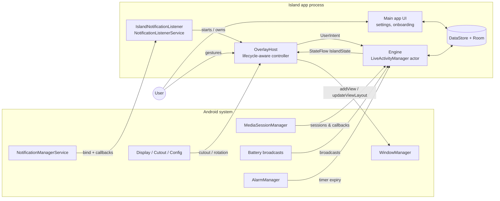
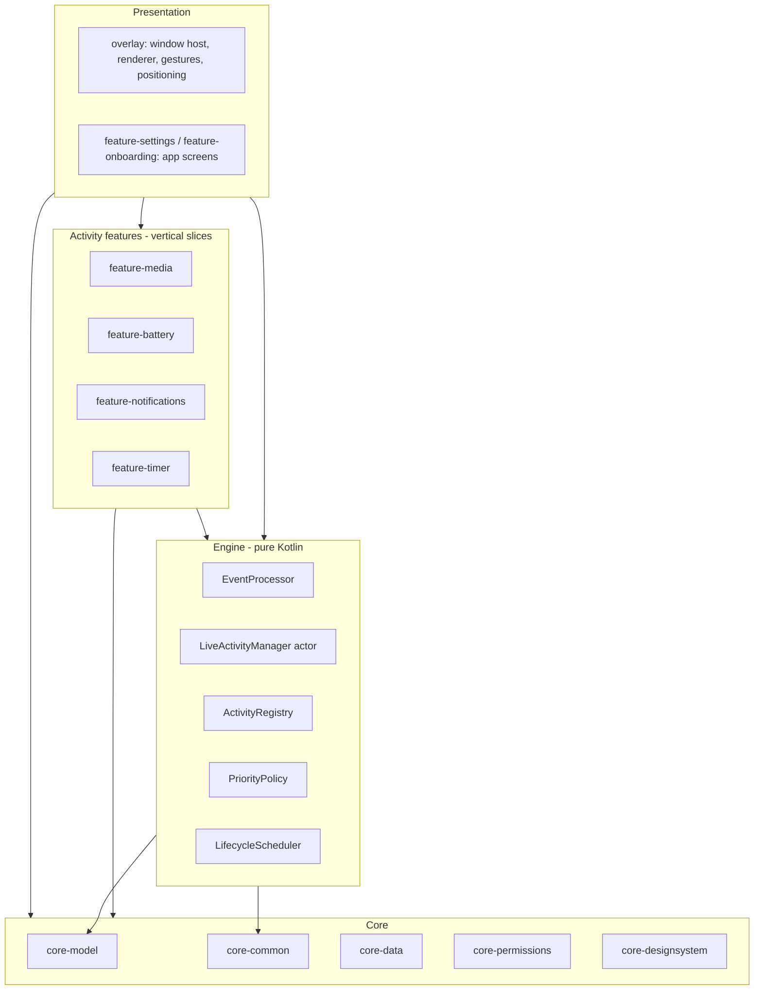
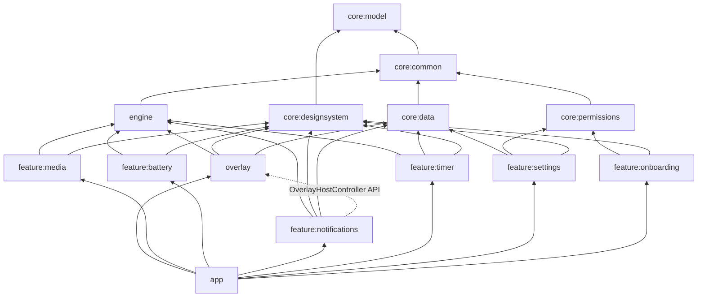
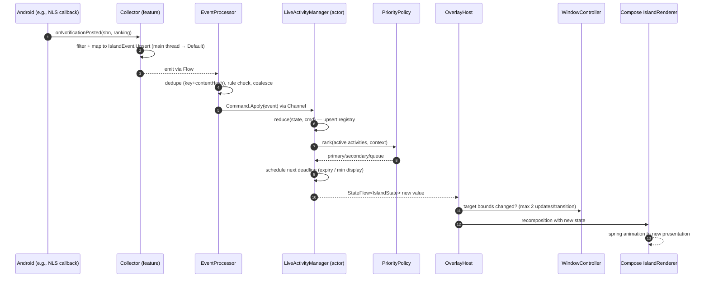
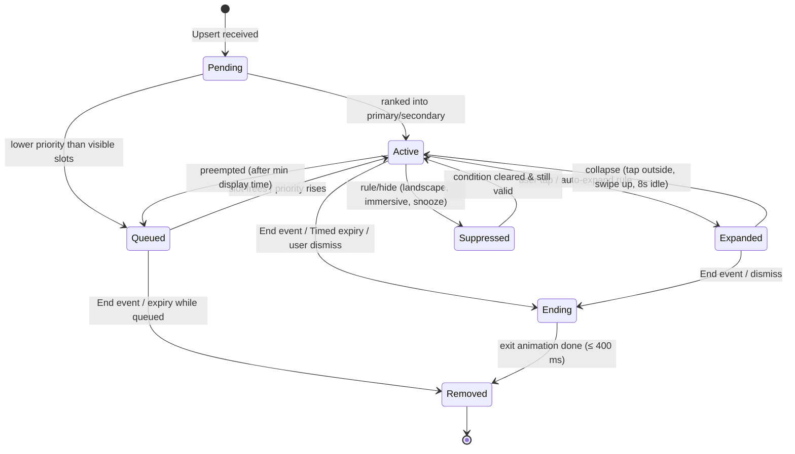
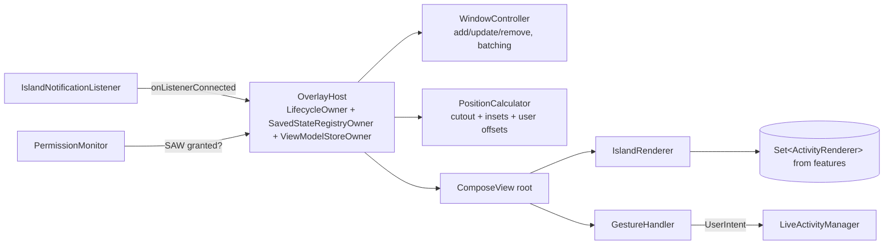
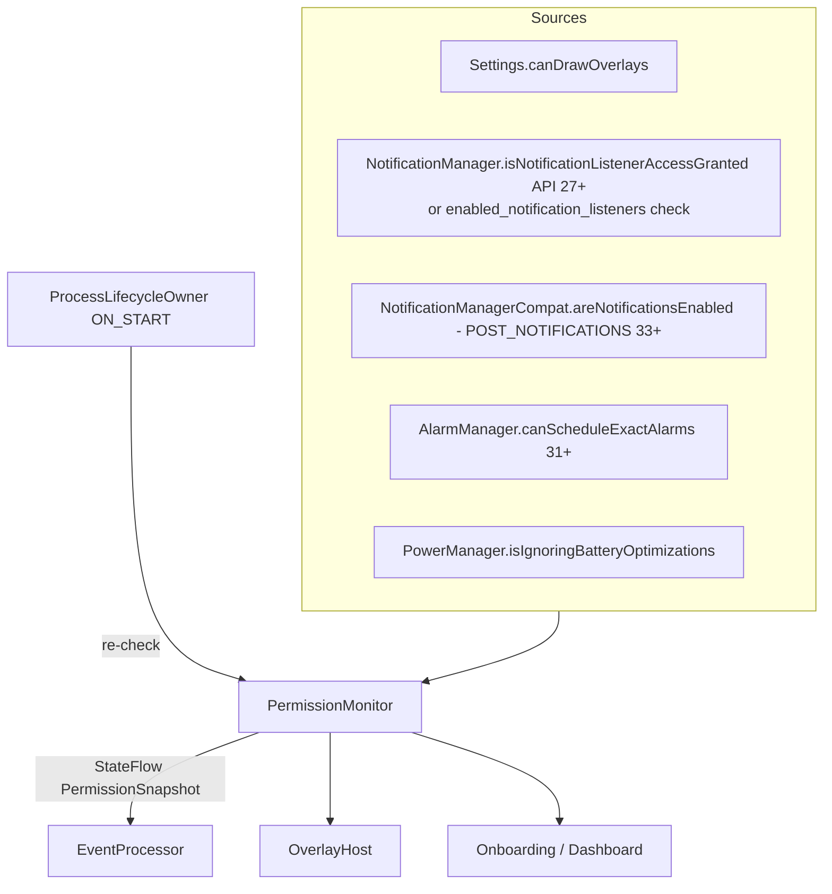

# Technical Architecture — Island

Version 0.1 · 2026-11-11 · Status: Draft for approval

---

## 1. Architectural goals

1. **One rendering surface, many activity types.** Adding an activity type means adding a feature module. The overlay is never touched.
2. **Event-driven, never polling.** Every update originates from a system callback, a user gesture, or a single scheduled deadline.
3. **Single writer of truth.** All island state mutations happen in one coroutine (actor). There are no locks and no races.
4. **Privacy by construction.** Sensitive data lives only in memory and only inside the engine's state. Persistence layers have no type that can hold notification content.
5. **Degrade, don't break.** Every permission is optional at the architecture level. Missing permissions disable collectors, not the app.
6. **Testable without a device.** Engine and models are pure Kotlin/JVM, driven by virtual time.

---

## 2. System context



**Key point:** the **NotificationListenerService (NLS) is the process anchor.** The system binds it at boot, after unlock, and after the process is killed, if the user enabled notification access. Binding is a natural, user-sanctioned way to keep the overlay process alive without an always-on foreground service. See ADR-04 and risk P2.

---

## 3. Layered architecture



Arrows point toward dependencies. **Nothing points upward.** The overlay never depends on a feature module. Features contribute renderers and collectors through Hilt multibinding (`@IntoSet`), assembled in `:app`.

---

## 4. Module structure

### 4.1 Proposed layout (modified from the brief, with justification)

```
island-android/
├── build-logic/                    # Convention plugins (android-library, compose, hilt, jvm-library, test)
├── gradle/libs.versions.toml       # Single version catalog
├── app/                            # Application, DI graph assembly, manifest, MainActivity, nav host
├── core/
│   ├── model/                      # [JVM] LiveActivity, IslandEvent, IslandState, ids, enums. No Android.
│   ├── common/                     # [JVM] Dispatchers, Clock/TimeSource, Result, logging facade
│   ├── data/                       # [Android] Room DB, DataStore, repositories (merges brief's datastore/ + data/)
│   ├── permissions/                # [Android] PermissionState flows, special-permission intents, OEM guidance
│   ├── designsystem/               # [Android] Tokens, theme, shared Compose components (brief's design/)
│   └── testing/                    # Fakes, test dispatchers, fixture builders (brief's testing/)
├── engine/                         # [JVM] processor, manager, registry, priority, lifecycle (packages, not modules)
├── overlay/                        # [Android] OverlayHost, WindowController, PositionCalculator, GestureHandler, IslandRenderer
├── feature/
│   ├── media/                      # MediaSessionCollector + mapper + Music renderer + controls
│   ├── battery/                    # BatteryCollector + mapper + Battery renderer
│   ├── notifications/              # IslandNotificationListener + filter + mapper + renderer
│   ├── timer/                      # TimerRepository, alarm receiver, boot receiver, renderer
│   ├── settings/                   # Dashboard, customization, activity mgmt, themes, privacy, about screens
│   └── onboarding/                 # Onboarding + permission setup flow
└── docs/
```

**Why vertical feature slices instead of separate `collectors/` and `activities/` trees:** in the brief's layout, every activity type is split across two modules (e.g., `collectors/media` + `activities/media`) that always change together. Merging them halves the module count (14 instead of ~30), keeps related code co-located, and still lets the engine stay ignorant of any concrete type. `calls/` is dropped because it is out of MVP scope.

**Why `engine` is one module with packages:** processor, manager, registry, priority, and lifecycle are tightly coupled through the actor and deploy together. Five modules would add build overhead with no isolation benefit. Package-level `internal` visibility plus a Konsist/ArchUnit-style test enforces boundaries.

### 4.2 Responsibilities and dependency direction

| Module | Type | Responsibility | May depend on | Must NOT depend on |
|---|---|---|---|---|
| `core:model` | JVM | Domain types: `LiveActivity`, `ActivityContent`, `IslandEvent`, `UserIntent`, `IslandState`, `ActivityId` | Kotlin stdlib, kotlinx-coroutines-core (Flow types only) | Anything Android |
| `core:common` | JVM | `DispatcherProvider`, `Clock` (wall + monotonic), `Logger` facade, `Feature` flags interface | `core:model` | Android |
| `core:data` | Android | Room DB + DAOs, DataStore serializers, repositories (`SettingsRepository`, `AppRuleRepository`, `TimerRepository`, `ThemeRepository`) | `core:model`, `core:common` | engine, overlay, features |
| `core:permissions` | Android | `PermissionMonitor` exposing `StateFlow<PermissionSnapshot>`; intents to settings screens; OEM detection and guidance content | `core:model`, `core:common` | engine, overlay, features |
| `core:designsystem` | Android | Tokens, `IslandTheme`, reusable composables (pill shapes, progress, buttons, settings rows) | `core:model` | engine, data |
| `core:testing` | JVM/Android | Fakes (`FakeClock`, `FakeCollector`, `FakeSettingsRepository`), `MainDispatcherRule`, builders | `core:*`, `engine` | features (features provide their own fakes) |
| `engine` | JVM | `EventProcessor`, `LiveActivityManager`, `ActivityRegistry`, `PriorityPolicy`, `LifecycleScheduler`, `EventCollector` interface | `core:model`, `core:common` | Android SDK, data, overlay, features |
| `overlay` | Android | `OverlayHost` (lifecycle owner), `WindowController`, `PositionCalculator`, `GestureHandler`, `IslandRenderer` (dispatches to `ActivityRenderer` set) | `engine`, `core:model`, `core:common`, `core:designsystem`, `core:data` (read settings) | any `feature:*` |
| `feature:media` | Android | `MediaSessionCollector`, `MediaActivityMapper`, `MediaRenderer`, `MediaCommandHandler` | `engine`, `core:*` | overlay, other features |
| `feature:battery` | Android | `BatteryCollector`, mapper, renderer | `engine`, `core:*` | overlay, other features |
| `feature:notifications` | Android | `IslandNotificationListener` (NLS, also process anchor), `NotificationFilter`, mapper, renderer, `NotificationActionHandler` | `engine`, `core:*`, **`overlay` (API only: `OverlayHost` start/stop)** | other features |
| `feature:timer` | Android | Timer/stopwatch domain, `TimerAlarmScheduler`, `TimerAlarmReceiver`, `BootReceiver`, renderer | `engine`, `core:*` | overlay, other features |
| `feature:settings` | Android | App screens and ViewModels | `core:*` | engine internals, overlay internals (talks via repositories, plus `IslandPreviewController` interface from `core:model`) |
| `feature:onboarding` | Android | Onboarding + permission flow | `core:*` | engine, overlay |
| `app` | Android | `Application`, Hilt graph, `MainActivity`, navigation, manifest merging, `ProcessLifecycle` wiring | everything | — |

> The NLS → overlay dependency is the one deliberate exception. The NLS is the process anchor and must start/stop the `OverlayHost`. It depends only on a narrow `OverlayHostController` interface exposed by `overlay`. If this feels wrong during implementation, move the interface to `core:model` and bind it in `app`.

### 4.3 Dependency graph



---

## 5. Domain model

### 5.1 Normalized events

All collectors convert platform callbacks into one sealed hierarchy **at the edge**. Platform types (`StatusBarNotification`, `MediaController`, `Intent`) never cross into the engine.

```kotlin
// core:model — sketch only, not final code
sealed interface IslandEvent {
    val source: EventSource          // MEDIA, BATTERY, NOTIFICATION, TIMER, SYSTEM
    val key: ActivityKey             // stable identity used for dedupe/upsert, e.g. "media:com.spotify.music"
    val occurredAt: Instant          // wall clock (for display)
    val monotonicAt: Long            // elapsedRealtimeNanos (for ordering/expiry)

    data class Upsert(..., val content: ActivityContent, val hints: PriorityHints) : IslandEvent
    data class End(..., val reason: EndReason) : IslandEvent       // source ended (paused 30s, notif removed, unplugged)
    data class Alert(..., val content: ActivityContent, val ttl: Duration) : IslandEvent  // transient (charging, full, low)
}

sealed interface SystemEvent {   // not activities; they change presentation rules
    data class ScreenState(val interactive: Boolean, val locked: Boolean)
    data class Orientation(val landscape: Boolean)
    data class Immersive(val fullscreen: Boolean)
    data class PermissionsChanged(val snapshot: PermissionSnapshot)
}

sealed interface UserIntent {
    data class Tap(val id: ActivityId) ; data class LongPress(val id: ActivityId)
    data object Collapse ; data class SwipeHorizontal(val direction: Int)
    data class Dismiss(val id: ActivityId) ; data class Action(val id: ActivityId, val action: ActionId)
    data class Snooze(val duration: Duration)
}
```

### 5.2 Generic LiveActivity

```kotlin
data class LiveActivity(
    val id: ActivityId,                   // (type, key) — dedupe identity
    val type: ActivityType,               // MEDIA, BATTERY, NOTIFICATION, TIMER, STOPWATCH (open set via registry)
    val content: ActivityContent,         // sealed, type-specific, immutable, @Immutable for Compose
    val priority: EffectivePriority,      // computed by PriorityPolicy; not set by collectors
    val lifecycle: LifecycleState,        // see §7
    val expiry: ExpiryPolicy,             // Persistent | Timed(d) | UntilDismissed
    val actions: List<ActivityAction>,    // generic (id, icon, label, enabled) — renderer maps to UI
    val createdAt: Long, val updatedAt: Long,   // monotonic
    val privacy: PrivacyLevel,            // FULL | REDACTED — renderer must honor
)

sealed interface ActivityContent {
    data class Media(val title: String, val artist: String?, val artwork: ImageRef?, val isPlaying: Boolean,
                     val position: PlaybackPosition?, val capabilities: Set<MediaCapability>, val appLabel: String)
    data class Battery(val level: Int, val charging: Boolean, val plugType: PlugType, val reason: BatteryReason)
    data class Notification(val appPackage: String, val appLabel: String, val appIcon: ImageRef,
                            val title: String?, val text: String?, val category: String?)
    data class Timer(val mode: TimerMode, val baseElapsedRealtime: Long, val durationMs: Long?, val running: Boolean)
}
```

`ImageRef` is an in-memory handle (key into a small LRU bitmap cache in the feature module), so `LiveActivity` stays cheap to compare and copy.

### 5.3 Island state (the only thing the overlay renders)

```kotlin
data class IslandState(
    val visibility: Visibility,           // VISIBLE | HIDDEN(reason: LANDSCAPE, IMMERSIVE, SNOOZED, NO_PERMISSION, USER_OFF)
    val presentation: Presentation,       // MINIMAL | COMPACT | COMPACT_SPLIT | EXPANDED
    val primary: LiveActivity?,
    val secondary: LiveActivity?,
    val queuedCount: Int,
)
```

---

## 6. Event flow

### 6.1 Collector → manager → renderer



### 6.2 How collectors talk to the manager

1. Each collector implements:
   ```kotlin
   interface EventCollector {
       val source: EventSource
       val requiredPermissions: Set<IslandPermission>
       fun events(): Flow<IslandEvent>   // cold; registers on collect, unregisters on cancel
   }
   ```
   It is implemented with `callbackFlow { register(...); awaitClose { unregister(...) } }`.
2. Hilt provides `Set<EventCollector>` (`@IntoSet` from each feature).
3. `EventProcessor` collects:
   ```kotlin
   combine(settings.enabledSources, permissions.snapshot) { enabled, perms -> collectors.filter { it.source in enabled && perms.grants(it.requiredPermissions) } }
       .distinctUntilChanged()
       .flatMapLatest { active -> active.map { it.events() }.merge() }   // start/stop collectors automatically
       .buffer(capacity = 64, onBufferOverflow = BufferOverflow.SUSPEND)
       .collect { event -> processAndSend(event) }
   ```
   Disabling an activity in settings therefore **unregisters its system callbacks** (battery receiver, media listener). This saves battery.
4. Exception: the **NLS is pushed to, not pulled from.** The system calls the service. The notification collector bridges this with a `MutableSharedFlow(extraBufferCapacity = 64, onBufferOverflow = DROP_OLDEST)` owned by a `@Singleton NotificationEventBridge`. The NLS writes to it with `tryEmit` (non-suspending, safe on the main thread). The collector's `events()` reads from it.
5. User intents from the overlay go directly to the manager's command channel. They bypass the processor.

### 6.3 Choosing the concurrency primitive

| Use | Primitive | Why |
|---|---|---|
| Island state for the renderer | `StateFlow<IslandState>` | Conflated latest value. Renderer only needs the newest state. Supports `distinctUntilChanged` for free |
| Settings, permission snapshot | `StateFlow` (via `stateIn(scope, Eagerly, default)`) | State-like, always has a value |
| Battery level from the system | `callbackFlow` + `distinctUntilChanged` + `conflate()` | Intermediate battery values are irrelevant |
| Notification events from NLS → collector | `MutableSharedFlow(replay = 0, extraBufferCapacity = 64, DROP_OLDEST)` | Hot, multi-event, must not suspend the binder/main thread. Dropping the oldest under burst is acceptable (they'd be superseded anyway) |
| Commands into the manager | `Channel<Command>(capacity = 128)` consumed by **one** coroutine | Single consumer, ordered, backpressure, actor semantics. A SharedFlow would allow multiple consumers and silently lose events with 0 subscribers |
| One-shot UI effects (haptic, "open app") from manager → host | `Channel<Effect>(BUFFERED)` exposed as `receiveAsFlow()` | Exactly-once delivery to a single consumer; not replayed on resubscribe |
| Deadlines (expiry, min display, timer tick) | Single `Job` in the actor scope: `delay(untilNextDeadline)` then send `Command.Tick` | One timer for the whole engine, not one per activity. Testable with virtual time |
| Media progress ticker | `flow { while(true) { emit(now); delay(frame/1s) } }` collected only inside the expanded composable | Scoped to visibility; stops automatically when collapsed |

**Rejected:** `Mutex`-guarded mutable maps (error-prone, harder to test); RxJava (extra dependency); `LiveData` (Android-bound, not for the engine); `kotlinx.coroutines.actor {}` builder (still marked obsolete API, so a plain `Channel` + `launch` loop is used instead).

### 6.4 Deduplication and coalescing (EventProcessor)

- **Dedupe key:** `(ActivityKey, contentHash)`. Identical upserts within 500 ms are dropped. This handles the NLS reposting notifications on ranking changes, and media apps firing `onMetadataChanged` 3–5 times per track change.
- **Coalesce window:** media metadata and playback-state changes within 50 ms for the same session are merged into one upsert. This prevents artwork flashing during track changes.
- **Rule application:** per-app notification rules and privacy level are applied here (rules come from a `StateFlow` snapshot, with no DB read per event).
- **Rate limit:** at most 1 notification alert per app per 3 s. Bursty chat apps collapse into "3 new messages" in v1.1 (P2).

---

## 7. Activity lifecycle



Rules:
- **Timed** activities count down from when they first become visible (not from creation), so a queued alert isn't wasted. Max queue age is 30 s, after which they are dropped.
- **Persistent** activities (media playing, running timer) end only when the source ends. Media gets a 30 s linger after pause.
- **Auto-expand:** off by default. Optional for timer completion and low battery.
- Expanded auto-collapses after 8 s without interaction (configurable 4–20 s).

---

## 8. Priority management

`EffectivePriority = basePriority(type, userOrder) + urgencyBoost + recencyBoost − staleness`

| Signal | Value | Example |
|---|---|---|
| User type order (settings) | 100 / 80 / 60 / 40 | User drags Music above Notifications |
| Urgency boost | +60 | Timer finished, battery ≤ 5 % |
| Transient alert boost | +40 for first 3 s | New notification, charger connected |
| Interaction boost | +30 while expanded | Don't preempt what the user is touching |
| Staleness | −1 per 10 s since last update (max −20) | An old notification yields to fresh media |

- **Preemption guard:** a visible activity cannot be preempted before `minDisplay` (2.5 s) unless the newcomer is urgent (≥ +60). An expanded activity is never preempted. The newcomer becomes `secondary` instead.
- **Split pill:** primary = rank 1, secondary = rank 2 if it's `Persistent`. Transient items never occupy the secondary slot; they preempt or queue.
- `PriorityPolicy` is a pure function. It is fully table-driven and unit-tested.

---

## 9. Overlay subsystem

### 9.1 Components



### 9.2 Hosting Compose in a WindowManager window
- A `ComposeView` added via `WindowManager.addView` has no `LifecycleOwner` by default and will crash on composition. `OverlayHost` implements `LifecycleOwner`, `SavedStateRegistryOwner`, and `ViewModelStoreOwner`. It sets them on the view via `setViewTreeLifecycleOwner` etc. before `addView`.
- Window context: use `context.createWindowContext(display, TYPE_APPLICATION_OVERLAY, null)` (API 30+) to get correct per-display resources and configuration. On API 29, fall back to the service context.
- Recomposer: default (`AndroidUiDispatcher`). The host's lifecycle goes to `RESUMED` when visible and `STARTED` when hidden (the view is `GONE`, not removed). It is destroyed only when the listener disconnects or the user turns the island off.

### 9.3 Window layout params

```text
type   = TYPE_APPLICATION_OVERLAY
flags  = FLAG_NOT_FOCUSABLE | FLAG_LAYOUT_IN_SCREEN | FLAG_LAYOUT_NO_LIMITS (evaluate in P1)
         | FLAG_WATCH_OUTSIDE_TOUCH (collapse on outside tap) | FLAG_HARDWARE_ACCELERATED
layoutInDisplayCutoutMode = LAYOUT_IN_DISPLAY_CUTOUT_MODE_ALWAYS (API 30+; SHORT_EDGES on 29)
gravity = TOP | START, x/y computed by PositionCalculator
format = PixelFormat.TRANSLUCENT
width/height = current island bounds + touch slop (never MATCH_PARENT)
```

### 9.4 Window resize strategy (performance-critical)

`updateViewLayout` triggers a cross-process relayout in the system server. Calling it every animation frame causes jank and wasted CPU.

**Strategy:** at transition start, grow the window **once** to `union(currentBounds, targetBounds)`. Animate the pill **inside** the window with Compose (`graphicsLayer` + `animateBounds`/`Animatable`). At transition end, shrink the window **once** to `targetBounds`.

- ≤ 2 `updateViewLayout` calls per transition. `WindowController` coalesces requests per frame using `Choreographer`.
- During the transition the window briefly covers a larger area. Touches there go to us, and we forward nothing. This is acceptable for ≤ 400 ms.
- **Rejected:** a permanently max-size window. It blocks touches beneath the expanded area. Android 12+ "untrusted touch" rules also block pass-through for non-touchable overlay windows with alpha > 0.8, so the "make it non-touchable" trick doesn't work.

### 9.5 Positioning
1. Anchor = center of `DisplayCutout.boundingRectTop`. Source: `WindowManager.currentWindowMetrics.windowInsets` (API 30+), or Jetpack WindowManager `WindowMetricsCalculator` + `Display.cutout` (API 29).
2. No top cutout → top-center at status-bar height / 2.
3. Corner camera (e.g., some Motorola/Samsung tablets) → user chooses "wrap camera" (pill grows sideways) or "center" (default).
4. Compact pill min width = cutout width + 2 × 24 dp (content lanes on either side of the camera).
5. Recompute on `onConfigurationChanged` (rotation, density, fold) and `DisplayManager.DisplayListener.onDisplayChanged`.

### 9.6 Visibility rules
| Condition | Detection | Reliability |
|---|---|---|
| Landscape | Configuration orientation | Reliable |
| Keyguard showing | `KeyguardManager.isKeyguardLocked` + `ACTION_USER_PRESENT`/`ACTION_SCREEN_OFF` | Reliable for content redaction. Whether `TYPE_APPLICATION_OVERLAY` shows above the lock screen varies by OS/OEM (test in P1) |
| Immersive/full-screen app | Overlay root's `WindowInsets` – `statusBars` visibility (`WindowInsetsCompat.isVisible`) | **Uncertain** — prototype P5. Fallback: hide when status bar insets are 0 for > 500 ms |
| Screen off | `ACTION_SCREEN_OFF`/`ON` (context-registered) | Reliable. Island lifecycle → `STARTED` (no frames) |
| Screen sharing/recording | `WindowManager.addScreenRecordingCallback` (API 35+) | API 35+ only. Earlier: not detectable. Content redacts when recording |

---

## 10. Architecture Decision Records (summary)

### ADR-01 Modular monolith with vertical feature slices
- **Decision:** 14 modules as in §4. Engine in one JVM module.
- **Alternatives:** single module (fast start, weak boundaries); the brief's 30-module layout (overhead, duplicated pairs).
- **Trade-off:** some upfront build-logic work in Week 1 (≈ 0.5 day) buys enforced boundaries and fast JVM unit tests.

### ADR-02 SDK levels
- **Decision:** `minSdk 29`, `targetSdk 36`, `compileSdk 37`.
- **Rationale:** Play requires target 36 for new apps and updates since 2026-08-31. API 29 is the lowest level with `Display.getCutout()` and the modern gesture-nav model.
- **Cost of 29 vs 31:** no `createWindowContext` (30), no `WindowMetrics` (30), no `getCutoutPath` (31), no dynamic color (31), different BAL/exact-alarm behavior, plus 2 extra OS versions to test. Android 10–11 share in late 2026 is expected to be small (verify in Play Console's device catalog).
- **Revisit:** end of Week 5. If API 29/30 workarounds exceed 2 dev-days total, raise to 31.
- **Target 37:** test compatibility in Week 5 (Android 17 IntentSender BAL hardening affects FR-NOT-05). Ship target 37 when Play requires it.

### ADR-03 Single overlay window, Compose rendering, ≤ 2 relayouts per transition
See §9.4. **Alternative:** a `View`-based renderer (lower memory, ~10–15 MB less). Keep Compose for velocity and animation APIs. If NFR-04 fails in Week 5, the overlay shell could move to Views, but feature renderers are composables and would also need rewriting. Compose memory is therefore measured in the Week 1 prototype, before many renderers exist. **Accepted risk.**

### ADR-04 Process anchoring: NLS-bound, no always-on FGS by default
- **Facts:**
  - The system binds enabled notification listeners from the system server and rebinds them after crash or boot.
  - A process with a visible `TYPE_APPLICATION_OVERLAY` window is treated as user-perceptible by the activity manager. This is AOSP behavior; OEM behavior varies.
- **Decision:** host the overlay in the app process while the listener is connected. No FGS notification is shown to the user.
- **Fallback ("Reliability mode", user opt-in, prototype-gated):** an `OverlayKeepAliveService` with `foregroundServiceType="specialUse"` and `PROPERTY_SPECIAL_USE_FGS_SUBTYPE` describing the "floating live activity overlay". It needs a Play Console FGS declaration with a video. Offered on OEMs where P2 shows kills, or when the user declines notification access but wants battery/timer.
- **Background start note:** on Android 15+, starting an FGS from the background with the SAW exemption requires a **currently visible** overlay window. Start the FGS from the app UI (foreground) or after the overlay is shown.
- **Why not `FOREGROUND_SERVICE_MEDIA_PLAYBACK` or `dataSync`:** we don't play media, and dataSync is time-limited (6 h/day on 15+) and wrong in policy terms. Misdeclared types are a top Play rejection cause.

### ADR-05 Single-writer actor engine
See §6.3. The reducer is `(State, Command) -> (State, List<Effect>)`, a pure function. The actor loop does I/O at the edges only.

### ADR-06 Hilt over Koin
| | Hilt | Koin |
|---|---|---|
| Graph validation | Compile time | Runtime (`verify()` in tests) |
| Android components (`Service`, `NotificationListenerService`, `BroadcastReceiver`) | `@AndroidEntryPoint` built-in | Manual `by inject()` |
| Multibinding (`Set<EventCollector>`, `Set<ActivityRenderer>`) | First-class `@IntoSet` | Possible, less idiomatic |
| Build cost | KSP/kapt overhead | None |
- **Decision:** Hilt with KSP. `core:model`, `engine`, and `core:common` stay DI-framework-free (constructor injection only, with `@Inject` from `javax.inject` allowed).

### ADR-07 No AccessibilityService, no backend, no analytics SDK
- Accessibility could put the overlay above the status bar (`TYPE_ACCESSIBILITY_OVERLAY`) and detect foreground apps. Play restricts the Accessibility API to apps whose core purpose is helping people with disabilities (`isAccessibilityTool`), or requires a prominent-disclosure and declaration process with high rejection risk. **The island must not depend on it.**
- No backend: no requirement justifies one. Billing verification is acceptable on-device for a low-price utility (with Play Integrity as an optional v1.1 hardening).

### ADR-08 Persistence split
DataStore (typed, kotlinx-serialization serializer) for a single settings document. Room for collections with queries (per-app rules, timers, custom themes). See DATABASE_DESIGN.md.

### ADR-09 Billing deferred off the critical path
Pro flags exist from Week 4. Play Billing Library (latest stable at integration time) is a Week 6 stretch goal.

---

## 11. Permission architecture



- **Re-check triggers:** app foreground (`ProcessLifecycleOwner`), `onListenerConnected`/`Disconnected`, and `AlarmManager.ACTION_SCHEDULE_EXACT_ALARM_PERMISSION_STATE_CHANGED`. There are no callbacks for SAW, so it is re-checked on foreground and on any `addView` `SecurityException`/`BadTokenException`.
- **Capability matrix:**

| Permission | Required for | Without it |
|---|---|---|
| `SYSTEM_ALERT_WINDOW` | Everything visual | Island cannot show. App shows a setup screen. Timer still works via notification |
| Notification access (NLS) | Notifications, **Media** (session access needs an enabled listener component), process anchoring | Battery + timer only, and the Reliability-mode FGS is needed to keep the overlay alive |
| `POST_NOTIFICATIONS` (33+) | Timer-finished notification, FGS notification | Timer alert shows on the island only while it's alive |
| `SCHEDULE_EXACT_ALARM` (31+, user-granted on 33/34+) | Exact timer expiry when the process is dead | Inexact alarm (may be minutes late in Doze). UI states this |
| Battery optimization exemption | Only for OEM reliability | Optional, never forced. Play allows requesting `REQUEST_IGNORE_BATTERY_OPTIMIZATIONS` only for acceptable use cases, so we deep-link to settings instead of using the direct-request intent |

---

## 12. Process death and reboot

| Scenario | Behavior |
|---|---|
| Process killed (low memory / OEM) | System rebinds NLS (timing varies: seconds on Pixel, sometimes never on aggressive OEMs until the app is opened). On `onListenerConnected` → host starts → engine rebuilds state: media sessions re-queried, battery sticky intent read, timers loaded from Room, active notifications via `getActiveNotifications()` (**not** re-alerted, only used for state) |
| Reboot | NLS bound after user unlock (direct-boot unaware by design). `BootReceiver` (`BOOT_COMPLETED`) re-arms timer alarms only. It does **not** start the overlay or an FGS |
| Listener disconnected by system | `onListenerDisconnected` → host torn down → `requestRebind(component)` |
| SAW revoked while running | `addView`/`updateViewLayout` throws → host stops gracefully → posts a "Island paused — tap to fix" notification (if allowed) |
| App updated | Process restarted, NLS rebound. Same as process death |

---

## 13. Architecture review (critical senior-engineer pass)

The plan above was challenged on the following points. Each has an outcome.

| # | Challenge | Assessment | Outcome |
|---|---|---|---|
| 1 | "**Consistent experience across manufacturers**" | Not fully achievable. Z-order under the status bar, lock-screen overlay visibility, OEM process killing, and HyperOS's extra "pop-up" permission all differ. | Reframe as *consistent where the platform allows, gracefully degraded elsewhere*. Add per-OEM capability flags (ANDROID_COMPATIBILITY §7). |
| 2 | The pill "sits around the camera like iOS" | `TYPE_APPLICATION_OVERLAY` is z-ordered **below** the status bar window. Status icons and the clock may draw over or next to the pill, and the shade covers it. iOS-like integration would need Accessibility (rejected) or system privileges. | **Prototype P1 on day 2.** Design accepts the constraint: compact pill content lives in the left/right lanes around the camera, where status icons usually aren't. Offer a "below status bar" position as an alternative. |
| 3 | No FGS will be killed on Chinese OEMs | Likely true on HyperOS/ColorOS with default battery settings. | Reliability mode (ADR-04 fallback) + OEM guidance screen. Measure in P2 before committing. |
| 4 | Compose in an overlay process is heavy | Plausible 15–25 MB overhead versus Views. | NFR-04 budget accounts for it. Measure in Week 1 prototype. Swap path documented. |
| 5 | Tapping a notification opens its app reliably | BAL rules (14+ sender opt-in, 17 IntentSender hardening), plus apps that create mutable/odd PendingIntents. | Prototype P3. Fallback: launch the app's launcher intent. Measure success rate on the top 20 apps. |
| 6 | Immersive detection without Accessibility | No official public API for "another app is full-screen". Insets on an overlay window are a heuristic. | Prototype P5. Worst case: offer a manual "hide in these apps" list, which can't work without usage access (`PACKAGE_USAGE_STATS`, a special permission). **Do not add `PACKAGE_USAGE_STATS` to MVP.** Accept "hide in landscape" as the main mitigation. |
| 7 | Notification content privacy | Android 15+ already redacts OTP content for untrusted listeners. We additionally redact on lock and screen recording. Content never hits disk, logs, or crash reports. | Lint rule plus code review checklist: no logging of `IslandEvent` payloads in release. Crash reports (if any) must not contain notification text. |
| 8 | Play review of NLS + SAW (+ maybe `specialUse` FGS) | This is a combination often seen in abusive apps. Review may be manual and slow. | Prominent disclosures, a privacy policy, and a demo video prepared in Week 6. Submit to closed testing early (Week 5) to surface review issues. |
| 9 | Platform convergence (Live Updates, Now Bar) | The biggest product risk. On Android 16+ Pixels, users already get status-bar chips. | Differentiate on cross-source unification, customization, and older OS support. P2: *consume* Live Updates from other apps via the NLS and render them in the island. |
| 10 | Six weeks is enough | Tight for one engineer, especially OEM work and Play review. | Roadmap has explicit P1 cut lines, and billing is off the critical path. |
| 11 | Timer reliability | Exact alarms are user-revocable. `USE_EXACT_ALARM` is restricted by Play to alarm/clock/calendar apps. | Use `SCHEDULE_EXACT_ALARM` with an in-app explanation and an inexact fallback. Don't claim "alarm clock" functionality. |
| 12 | Over-modularization | 14 modules for an MVP may still be a lot. | Accept; convention plugins keep it cheap. Don't split further without a reason. |

Residual high risks are tracked in ANDROID_COMPATIBILITY.md §9 (risk register).
