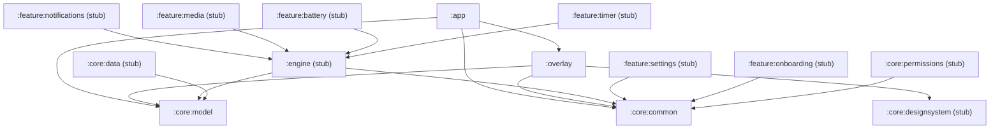

# Milestone 1: Android Foundation & Floating Overlay Design Specification

- **Date:** 2026-11-11
- **Status:** Approved Draft
- **Target Milestone:** Milestone 1 (Week 1 of 6-Week Roadmap)
- **Scope:** Multi-module build setup, convention plugins, core domain models, overlay window host, and cutout-aware position calculator.

---

## 1. Executive Summary & Goals

Milestone 1 establishes the Android multi-module architecture for "Island" (Android Live Activities) and delivers the core overlay display subsystem. It replaces the placeholder Kotlin/JVM console template with a modern, modular Android project conforming to the architectural blueprint in `docs/TECHNICAL_ARCHITECTURE.md`.

### Key Outcomes:
1. Initialize Git version control and preserve initial state.
2. Replace single-file build with a multi-module Gradle build using Gradle Version Catalog (`gradle/libs.versions.toml`) and composite `build-logic` convention plugins.
3. Configure target SDKs (`minSdk 29`, `targetSdk 36`, `compileSdk 37`, JVM 21).
4. Scaffold all 14 project modules with strict dependency boundaries.
5. Implement `:core:model` and `:core:common` with zero Android framework dependencies (`explicitApi()` enabled).
6. Implement `:overlay` containing `OverlayHost` (Lifecycle-bound Service), `WindowController` (coalesced window layout updates, `TYPE_APPLICATION_OVERLAY`), and `PositionCalculator` (cutout-aware geometric placement).
7. Implement `:app` with a debug `MainActivity` to request `SYSTEM_ALERT_WINDOW` permission and toggle test pill states for prototype validation (P1, P4, P5).

---

## 2. Build System & Module Hierarchy

### 2.1 Version Catalog (`gradle/libs.versions.toml`)
The project utilizes Gradle's version catalog with stable dependencies:
- **Plugins:** Android Gradle Plugin (`8.8.2`), Kotlin (`2.1.10`), Compose Compiler plugin, Hilt (`2.55`), KSP (`2.1.10-1.0.30`).
- **Compose BOM:** `androidx.compose:compose-bom:2025.02.00` (Material 3, Foundation, UI, Runtime, Icons).
- **Core AndroidX:** `androidx.core:core-ktx:1.15.0`, `androidx.lifecycle:lifecycle-runtime-compose:2.8.7`, `androidx.lifecycle:lifecycle-service:2.8.7`.
- **Coroutines:** `kotlinx-coroutines-android:1.10.1`, `kotlinx-coroutines-test:1.10.1`.
- **Serialization:** `kotlinx-serialization-json:1.8.0`.
- **Testing:** JUnit 5 / JUnit 4, Truth, Turbine (`1.2.0`), MockK (`1.13.16`).

### 2.2 `build-logic` Convention Plugins
A composite build located at `/build-logic`:
- `island.android.application`: Applied to `:app`. Sets target/compile/min SDKs, enables Java 21, configures standard Android packaging options and ProGuard/R8 optimization.
- `island.android.library`: Applied to Android library modules (`:overlay`, `:core:designsystem`, `:core:data`, `:core:permissions`, `:feature:*`).
- `island.android.compose`: Enables Jetpack Compose, attaches Compose compiler plugin, and applies the Compose BOM.
- `island.jvm.library`: Applied to pure Kotlin JVM modules (`:core:model`, `:core:common`, `:engine`). Configures JVM 21, enables Kotlin `explicitApi()`, and strictly disallows `android.*` dependencies.
- `island.hilt`: Configures Hilt annotation processor (KSP) and Hilt runtime dependencies.
- `island.test`: Standard unit test runner and assertion libraries.

### 2.3 Module Graph (14 Modules)


---

## 3. Core Domain Models (`:core:model` & `:core:common`)

### 3.1 `:core:model`
Pure Kotlin JVM data structures defining the state machine:
- `IslandState`: Sealed interface representing overlay states:
  - `Hidden`: No visible overlay (screen off, user dismissed, landscape mode, or zero active activities).
  - `Compact`: Minimal pill around camera cutout (`leadingSlot`, `trailingSlot`, `centerContent`).
  - `Expanded`: Detailed floating card (`header`, `contentSlot`, `actions`).
  - `Split`: Dual-bubble display for concurrent activities.
- `LiveActivity`: Representation of an active activity:
  - `id: String`, `source: ActivitySource`, `priority: ActivityPriority`, `timestamp: Long`, `timeoutMs: Long?`, `content: ActivityContent`.
- `ActivitySource`: Enum (`NOTIFICATION`, `MEDIA`, `BATTERY`, `TIMER`).
- `UserIntent`: Sealed hierarchy for touch events:
  - `Tap(val activityId: String)`, `LongPress(val activityId: String)`, `SwipeHorizontal(val direction: Direction)`, `SwipeVertical(val direction: Direction)`, `ActionClick(val activityId: String, val actionId: String)`.

### 3.2 `:core:common`
- `DispatcherProvider`: Interface and default implementation (`DefaultDispatcherProvider`) for injecting `Main`, `IO`, `Default`, and `Unconfined` coroutine dispatchers.
- `IslandResult<T>`: Functional sealed error wrapper (`Success(val data: T)`, `Failure(val error: Throwable)`).

---

## 4. Overlay Architecture (`:overlay`)

### 4.1 `OverlayHost`
An Android `LifecycleService` responsible for hosting Compose in the system `WindowManager`:
- Implements `LifecycleOwner`, `ViewModelStoreOwner`, and `SavedStateRegistryOwner`.
- Decorates the created `ComposeView` with `ViewTreeLifecycleOwner`, `ViewTreeViewModelStoreOwner`, and `ViewTreeSavedStateRegistryOwner`.
- Creates and attaches a custom `Recomposer` driven by the service's `lifecycleScope`.
- Subscribes to device configuration and screen state broadcasts (`ACTION_SCREEN_OFF`, `ACTION_SCREEN_ON`) to throttle composition while the screen is off.
- Binds to `WindowManager.addView()` on start, and calls `WindowManager.removeViewImmediate()` on `onDestroy()`.

### 4.2 `WindowController` (ADR-03 Compliance)
Controls window placement, touch routing, and resize coalescing:
- **Layout Parameters:**
  ```kotlin
  WindowManager.LayoutParams(
      WindowManager.LayoutParams.WRAP_CONTENT,
      WindowManager.LayoutParams.WRAP_CONTENT,
      WindowManager.LayoutParams.TYPE_APPLICATION_OVERLAY,
      WindowManager.LayoutParams.FLAG_NOT_FOCUSABLE or
          WindowManager.LayoutParams.FLAG_LAYOUT_NO_LIMITS or
          WindowManager.LayoutParams.FLAG_LAYOUT_IN_SCREEN or
          WindowManager.LayoutParams.FLAG_WATCH_OUTSIDE_TOUCH,
      PixelFormat.TRANSLUCENT
  ).apply {
      gravity = Gravity.TOP or Gravity.CENTER_HORIZONTAL
  }
  ```
- **Coalesced Layout Resizes:**
  - Window resizes via `updateViewLayout` cause system-server IPC and GPU buffer reallocation.
  - Updates are throttled to at most **twice per state transition**:
    1. Pre-animation resize: immediately expand the window bounds to enclose the target bounds before the Compose transition starts.
    2. Post-animation settle: snap window bounds to the exact touch bounding box when the transition reaches terminal state.
- **Touch Filtering:**
  - Touches inside the pill are consumed by Compose gesture detectors.
  - Touches outside the pill pass directly through to the underlying application (`FLAG_NOT_TOUCH_MODAL` & `FLAG_NOT_FOCUSABLE`).

### 4.3 `PositionCalculator`
Calculates cutout coordinates and safe bounds:
- Inspects `WindowInsets.getDisplayCutout()` or `DisplayCutoutCompat`.
- Computes cutout bounding rectangle:
  - **Center Punch-hole:** Centers the compact pill symmetrically around the punch hole.
  - **Notch:** Anchors the pill directly underneath or encompassing the notch width.
  - **Corner / Off-center Hole:** Centers on cutout if within reasonable bounds, or falls back to center-top.
  - **No Cutout:** Positioned at top-center with a default margin of `statusBarHeight + 4.dp`.
- **Orientation Awareness:**
  - Detects `Configuration.ORIENTATION_LANDSCAPE` and immediately signals `IslandState.Hidden`.

---

## 5. Test Harness & Prototypes (`:app`)

### 5.1 `MainActivity` Debug Controller
- Checks `Settings.canDrawOverlays(context)`.
- If permission missing, launches `Settings.ACTION_MANAGE_OVERLAY_PERMISSION` intent.
- Provides debug buttons:
  - Start / Stop `OverlayHost`.
  - Toggle `Compact` state (pill around cutout).
  - Toggle `Expanded` state (card transition).
  - Toggle `Hidden` state.

### 5.2 Verification Prototypes
- **Prototype P1 (Cutout Alignment & Z-Order):**
  - Verify centered alignment on camera cutout (± 1 dp) on emulator with punch hole / notch.
  - Confirm overlay behavior with status bar.
- **Prototype P4 (Layout Resize Throttling):**
  - Instrument `WindowController` debug counters to verify ≤ 2 `updateViewLayout` calls per transition.
- **Prototype P5 (Immersive / Landscape Handling):**
  - Verify overlay hides completely when rotated to landscape.

---

## 6. Definition of Done for Milestone 1

1. Git repo initialized with initial template commit preserved.
2. Root Gradle build and `settings.gradle.kts` converted to multi-module Android structure.
3. Gradle Version Catalog (`libs.versions.toml`) and `build-logic` plugins compiling cleanly.
4. All 14 modules present in `settings.gradle.kts` with valid build scripts.
5. `:core:model` and `:core:common` unit tested with zero Android imports.
6. `PositionCalculatorTest` unit tests passing across all cutout configurations (center, notch, corner, none, landscape).
7. `WindowControllerTest` passing unit tests for layout flag configuration and update coalescing.
8. `./gradlew build` and `./gradlew test` pass cleanly.
