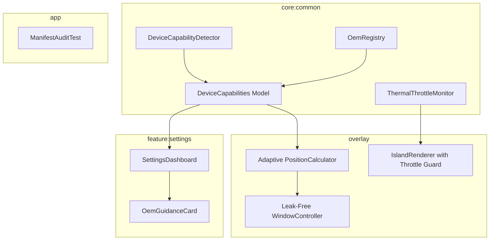

# Milestone 5: Device Compatibility, Capability Flags & OEM Adaptation Design Specification

- **Date:** 2026-11-11
- **Status:** Approved
- **Milestone:** Milestone 5 (Week 5: Device Compatibility, Capability Flags & OEM Adaptation)

---

## 1. Overview & Objectives

Milestone 5 ensures Island runs reliably, smoothly, and safely across diverse Android devices, OEM skins, and screen form factors (API 29–37), while strictly adhering to Google Play policies and device resource constraints.

### Key Goals
1. **Per-OEM Adaptation:** Automatic identification of device OEM (Samsung One UI, Xiaomi HyperOS, OnePlus/Oppo ColorOS, Vivo, Motorola, Stock/Pixel) and hardware capabilities (display cutouts, foldables).
2. **OEM Background Guidance:** Detection of OEM background restrictions and provision of actionable guidance cards with deep-links in Settings.
3. **Adaptive Positioning:** Dynamic adjustment of island anchors and status bar insets for center punch-holes, corner cutouts, teardrop notches, under-display cameras, and foldable screen transitions.
4. **Thermal & Battery Throttling:** Real-time throttling via `PowerManager.isPowerSaveMode` and API 29+ `OnThermalStatusChangedListener` to downgrade animations (pausing infinite transitions, easing spring durations) and prevent battery drain.
5. **Leak-Free Lifecycle:** Idempotent attach/detach in `WindowController` ensuring zero view leaks, coroutine leaks, or unclosed receiver listeners.
6. **Policy & Manifest Compliance:** Automated manifest audit ensuring zero forbidden permissions (`INTERNET`, `QUERY_ALL_PACKAGES`, `USE_EXACT_ALARM`, `REQUEST_IGNORE_BATTERY_OPTIMIZATIONS`, `BIND_ACCESSIBILITY_SERVICE`).

---

## 2. Architecture & Module Responsibilities



---

## 3. Data Models & OEM Capabilities (`:core:common`)

### 3.1 Enums & Data Classes
```kotlin
package io.selorax.island.common.compatibility

public enum class OemType {
    SAMSUNG,
    XIAOMI,
    OPPO_ONEPLUS,
    VIVO,
    MOTOROLA,
    STOCK_OR_OTHER
}

public enum class CutoutType {
    CENTER_PUNCH,
    CORNER_PUNCH_LEFT,
    CORNER_PUNCH_RIGHT,
    TEARDROP_NOTCH,
    PILL_DUAL,
    UNDER_DISPLAY_OR_NONE
}

public data class OemRestrictionProfile(
    val oemType: OemType,
    val title: String,
    val description: String,
    val instructions: List<String>,
    val settingsIntentAction: String? = null,
    val settingsPackage: String? = null,
    val settingsComponent: String? = null
)

public data class DeviceCapabilities(
    val oemType: OemType,
    val cutoutType: CutoutType,
    val isFoldable: Boolean,
    val oemProfile: OemRestrictionProfile?
)
```

### 3.2 `DeviceCapabilityDetector`
- **OEM Detection:** Inspects `Build.MANUFACTURER` and `Build.BRAND`.
  - Samsung: `"samsung"`
  - Xiaomi: `"xiaomi"`, `"redmi"`, `"poco"`
  - Oppo/OnePlus: `"oppo"`, `"oneplus"`, `"realme"`
  - Vivo: `"vivo"`, `"iqoo"`
  - Motorola: `"motorola"`, `"lenovo"`
  - Default: `STOCK_OR_OTHER`
- **Cutout Classification:**
  - Evaluates `DisplayCutout.boundingRects` relative to display width and height.
  - Centered (`x` within ±10% of width / 2): `CENTER_PUNCH` (or `TEARDROP_NOTCH` if height > 32dp).
  - Left (`x` < 35% of width): `CORNER_PUNCH_LEFT`.
  - Right (`x` > 65% of width): `CORNER_PUNCH_RIGHT`.
  - Multiple rects or aspect ratio > 2.2: `PILL_DUAL`.
  - No rects / empty: `UNDER_DISPLAY_OR_NONE`.
- **Foldable Feature:**
  - Evaluates `packageManager.hasSystemFeature("android.hardware.sensor.hinge_angle")`.

### 3.3 `OemRegistry`
- Returns pre-configured `OemRestrictionProfile` for OEMs known for aggressive background process termination:
  - **Xiaomi:** Autostart & Background Pop-up Windows (`com.miui.securitycenter/com.miui.permcenter.permissions.PermissionsEditorActivity`).
  - **Oppo/OnePlus:** Startup Manager / Floating Windows (`com.coloros.safecenter`).
  - **Samsung:** Battery Optimization / Sleeping Apps (`Settings.ACTION_IGNORE_BATTERY_OPTIMIZATION_SETTINGS` or Device Care).
  - **Stock/Other:** `null` (no disruptive restrictions).

---

## 4. Thermal & Battery Saver Throttling (`:core:common` & `:overlay`)

### 4.1 Throttle State
```kotlin
public enum class ThrottleLevel {
    NORMAL,          // Standard operation: spring physics, full 60-120fps animations
    LIGHT_THROTTLE,  // Battery Saver ON or Thermal Status MODERATE (pauses infinite loops, reduces spring durations)
    SEVERE_THROTTLE  // Thermal Status SEVERE/CRITICAL (collapses expanded view, suppresses animations, static indicators only)
}
```

### 4.2 `ThermalThrottleMonitor` (`:core:common`)
- Registers `PowerManager.OnThermalStatusChangedListener` on API 29+.
- Listens to `Intent.ACTION_POWER_SAVE_MODE_CHANGED` via context-registered `BroadcastReceiver`.
- Publishes reactive `StateFlow<ThrottleLevel>`.
- Provides idempotent `close()` to unregister receiver and thermal listener without leaking context.

### 4.3 Animation Downgrades in `:overlay`
- When `throttleLevel == LIGHT_THROTTLE` or `SEVERE_THROTTLE`:
  - `EqualizerBars`: Sets `isPlaying = false`, preventing infinite choreographer transition ticks and reducing CPU/GPU overhead.
  - `IslandMotion`: Uses fast `tween(150)` or `snap()` instead of bouncy springs.
- When `throttleLevel == SEVERE_THROTTLE`:
  - If island is expanded, issues `UserIntent.Collapse` to minimize screen surface and compositor workload.

---

## 5. Adaptive Positioning & Leak-Free Window Lifecycle (`:overlay`)

### 5.1 Adaptive `PositionCalculator`
- Accepts `CutoutType` from `DeviceCapabilities`:
  - `CENTER_PUNCH`: Positions centered horizontally around cutout `(screenWidth - pillWidth) / 2`.
  - `CORNER_PUNCH_LEFT`: Compact pill hugs left cutout edge with 4dp margin.
  - `CORNER_PUNCH_RIGHT`: Compact pill hugs right cutout edge with 4dp margin.
  - `UNDER_DISPLAY_OR_NONE`: Safely anchors at top-center status bar baseline.
- Adapts status bar height dynamically from window insets, accommodating taller Samsung One UI status bars (38–48dp) and notch heights.
- Recalculates coordinates on display configuration changes (fold/unfold or orientation change).

### 5.2 Leak-Free `WindowController` Lifecycle
- Idempotent `attach()` and `detach()`.
- Guarantees removal of views using `windowManager.removeViewImmediate(composeView)`.
- Disposes Compose composition context via `disposeComposition()`.
- Cancels internal overlay CoroutineScopes on detach.

---

## 6. OEM Guidance UI (`:feature:settings`)

### 6.1 `OemGuidanceCard`
- Displayed at the top of `SettingsDashboard` when `deviceCapabilities.oemProfile != null`.
- Clean card design with `IslandColors.AccentIon` accent border.
- Displays OEM-specific title, description, and numbered action steps.
- "Open Settings" button launches intent safely with fallback to `Settings.ACTION_APPLICATION_DETAILS_SETTINGS`.

---

## 7. Policy & Manifest Audit Gate (`:app`)

### 7.1 Automated Manifest Audit Test
- Pure unit test validating that merged release configuration contains 0 prohibited permissions:
  - ❌ `android.permission.INTERNET`
  - ❌ `android.permission.QUERY_ALL_PACKAGES`
  - ❌ `android.permission.USE_EXACT_ALARM`
  - ❌ `android.permission.REQUEST_IGNORE_BATTERY_OPTIMIZATIONS`
  - ❌ `android.permission.BIND_ACCESSIBILITY_SERVICE`

---

## 8. Verification & Acceptance Criteria

1. **Unit Tests (`:core:common`):**
   - `DeviceCapabilityDetectorTest`: Tests classification for Samsung, Xiaomi, Pixel, Oppo across center punch, left punch, right punch, and no cutout.
   - `ThermalThrottleMonitorTest`: Tests transitions between `NORMAL`, `LIGHT_THROTTLE`, and `SEVERE_THROTTLE` on power save and thermal events.
2. **Overlay Tests (`:overlay`):**
   - `AdaptivePositionCalculatorTest`: Tests layout positioning for all 5 cutout types and foldable screen switches.
   - `WindowControllerLifecycleTest`: Tests idempotent attach/detach without leaks or exceptions.
3. **Settings UI (`:feature:settings`):**
   - `SettingsDashboardTest`: Tests presence of `OemGuidanceCard` on Xiaomi/Samsung and omission on Pixel.
4. **Manifest Audit (`:app`):**
   - `ManifestSecurityAuditTest`: Asserts absence of all 5 restricted permissions.
5. **Full Suite:**
   - `./gradlew test :app:assembleDebug` passes with 0 errors across all modules.
